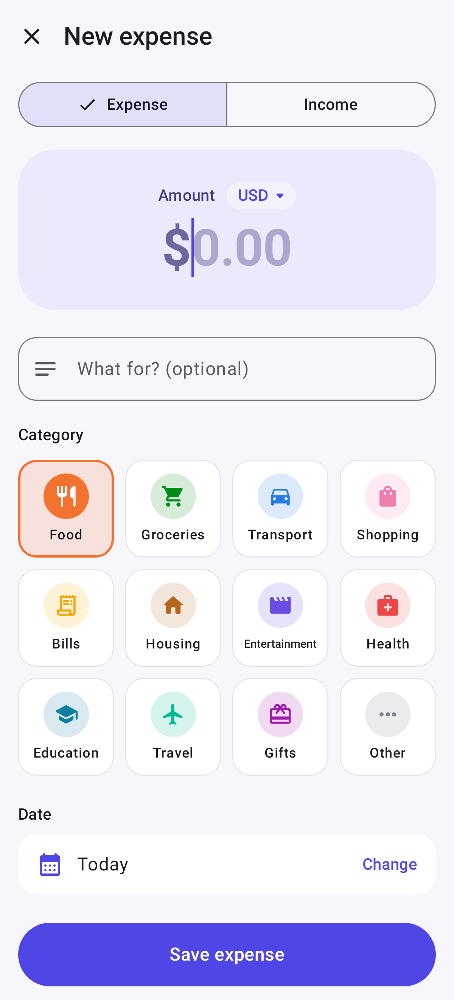
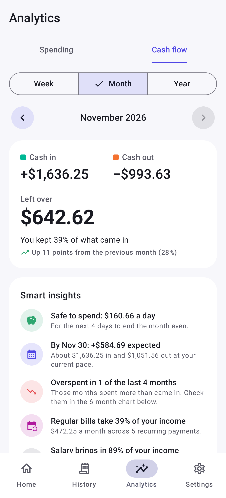
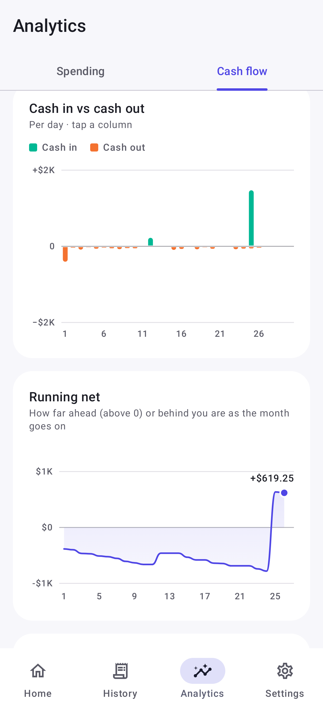
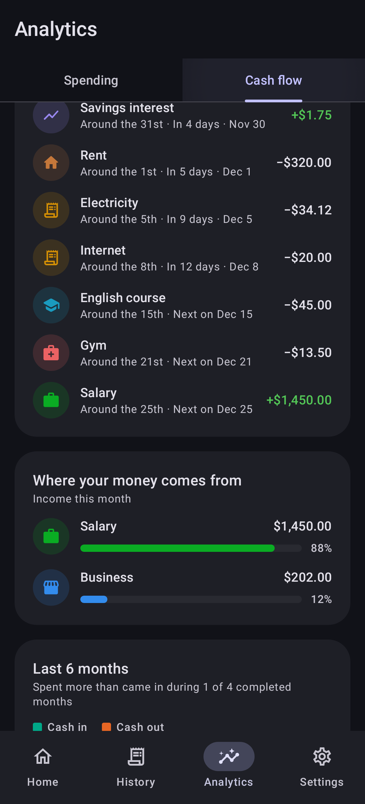
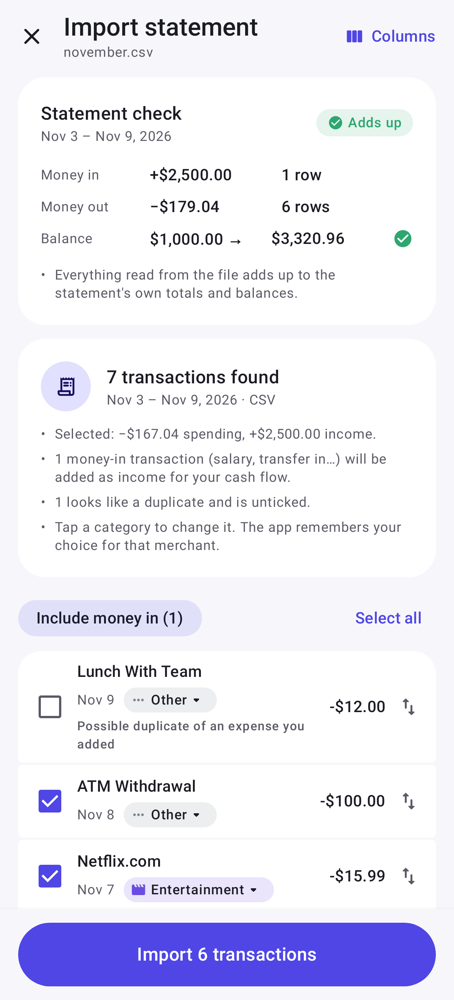
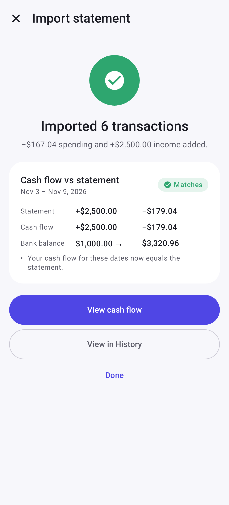
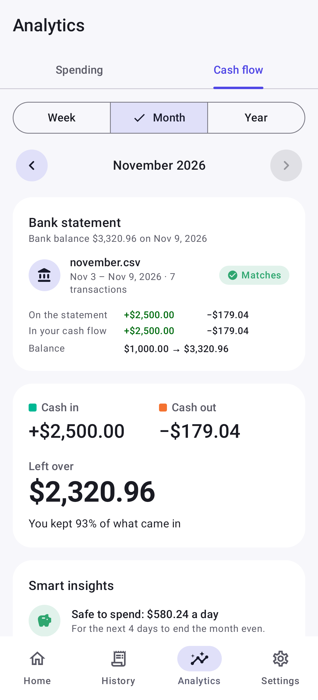

# Expense Tracker

An Android app for tracking daily expenses and income, and seeing where your money goes and what's left, with interactive charts.
Built with Kotlin, Jetpack Compose and Material 3. Everything is stored on the device; there's no account and no internet use.

<p>
  
  
  
</p>
<p>
  
  
  
</p>
<p>
  
  
  
</p>
<p>
  
  
  
</p>

## Features

- **Fast entry**: switch between Expense and Income, big amount field, color-coded categories (12 for spending, 7 for income: Salary, Business, Interest & investments, Refunds, Gifts received, Transfers in, Other), quick "Today / Yesterday" dates, optional note.
- **Home dashboard**: this month's total vs. last month, a monthly budget progress bar, today and this week, last 7 days chart, top categories and recent transactions.
- **Analytics** by week, month or year (step back through past periods):
  - Donut chart by category (top 5 plus the rest grouped), with a legend that shows each share and amount
  - Column chart of daily (or monthly) totals; tap a column to see its value
  - 6-month trend line; tap a point to see its value
  - Insights: biggest category, largest expense, the weekday you spend most, daily average, change vs. the previous period
- **Smart cash flow** (Analytics → Cash flow, and a card on Home):
  - Cash in, cash out, what's left over, and how much of your income you kept compared with last period
  - **Safe to spend per day** for the rest of the month. It counts salary that hasn't arrived yet and regular bills that are still due.
  - **Month-end forecast**: expected money in and out at your current pace (monthly bills are left out of the daily pace, so rent doesn't skew it)
  - **Regular income & bills**, found automatically: anything that comes back about once a month, in consecutive months, on a similar day and for a similar amount. Each shows its next expected date.
  - How much of your income goes on regular bills, your main income sources, and how many recent months you spent more than came in
  - Charts: cash in vs cash out (bars going up and down from zero), running net through the period, and the last 6 months
- **History**: browse by month, filter by All / Spending / Income and by category, search notes, swipe left to delete (with Undo), tap to edit.
- **Import bank statements** (CSV, Excel .xlsx or PDF) from History, Settings or the empty Home screen:
  - Columns are detected automatically (Date, Description, Amount or Money in/out, DR/CR). The date format is detected too, including telling 03/11 = 3 Nov apart from 11 Mar.
  - PDFs are read using where each word sits on the page, so Money in / Money out / Balance columns are told apart. If there's no column header, the running balance decides whether money went in or out. Password-protected PDFs are supported.
  - On the review screen, spending and money coming in (imported as income) are pre-selected, each with a suggested category. Duplicates are unticked: rows already imported, or ones that match something you typed in.
  - **Statement check** before you import: money in and out are compared with the statement's printed totals, and opening balance + in − out with the closing balance. When the file has a running balance, it decides whether each row was money in or out. If a row is still the wrong way round, tap ⇅ on it and the check updates.
  - Handles dates printed with a time (`15/11/2026 10:32`), amounts with dot thousands (`40.000`), and the many ways banks mark money in: `+1,000.00`, `CR 1,000.00`, Credit / Cash In / Received / Money In columns, and Type columns ("Money In", "Income", "DR/CR").
  - The statement is saved. The Cash flow tab shows your **bank balance** and checks that your cash flow for the statement's dates still matches it. If it doesn't, it says why: other entries in those dates (sample data or typed in by hand), or statement rows that weren't imported.
  - Change a category once and it's remembered for that merchant in future imports. Re-importing the same file won't create duplicates.
  - The file is read on the phone; nothing is uploaded.
- **Settings**: 12 currencies (USD, EUR, KHR, THB, VND, …), monthly budget, light/dark/system theme, Material You dynamic color (Android 12+), CSV export through the share sheet, add or remove sample data, remove imported transactions (to re-import), delete all.

## Install on your phone

**Easiest:** open the repository's **Actions** tab on GitHub, open the latest *Android build* run, and download the `expense-tracker-apks` artifact. Copy `app-release.apk` to your phone and open it. You'll need to allow installing from unknown sources.

**From source:** open the project in Android Studio (latest stable) and press Run, or use the command line with JDK 17+ and the Android SDK:

```bash
./gradlew assembleRelease     # → app/build/outputs/apk/release/app-release.apk (~8.5 MB, mostly PDF fonts)
./gradlew installDebug        # install a debug build on a connected device
```

> Without an upload key, the release build is signed with the debug key so it installs directly on your phone.

## Publish on Google Play

Everything is set up: release signing from `keystore.properties` (or GitHub secrets), `./gradlew bundleRelease`
for the App Bundle, store graphics in [`docs/play-store/`](docs/play-store/), and a
[privacy policy](docs/privacy-policy.md). Follow the step-by-step guide in **[docs/PUBLISHING.md](docs/PUBLISHING.md)**.

## Tech stack

| Area | Choice |
|---|---|
| UI | Jetpack Compose, Material 3, edge-to-edge, light/dark and dynamic color |
| Charts | Hand-written with Compose `Canvas` (no chart library): donut, column, smoothed line |
| Storage | Room (expenses, learned merchant categories), DataStore Preferences (settings); exported schemas in `app/schemas` |
| Statement import | Own CSV and .xlsx readers; [PdfBox-Android](https://github.com/TomRoush/PdfBox-Android) for PDF text |
| Architecture | MVVM: `ViewModel` + `StateFlow`, a single-activity Navigation Compose app, a small manual DI container |
| Min / target SDK | 26 (Android 8.0) / 36 |

```
app/src/main/java/com/expensetracker/
├── data/        Room entity + DAO, repositories, settings, sample data
├── domain/      Analytics.kt (spending) and CashFlow.kt (in/out, recurring items, forecast) — pure Kotlin, unit-tested
├── importer/    statement import: CSV/XLSX readers, column detection, PDF parser, category guesser
├── ui/
│   ├── charts/      DonutChart, BarChart, LineChart, CashFlowChart (diverging in/out)
│   ├── components/  cards, rows, category colors and icons
│   ├── home/ history/ analytics/ edit/ settings/ importer/   one screen + ViewModel each
│   └── theme/       colors, typography, shapes
└── util/        money/date formatting, amount input sanitizing
```

## Tests

```bash
./gradlew testDebugUnitTest        # all tests
./gradlew recordRoborazziDebug     # also re-record docs/screenshots/*.png
```

- `AnalyticsTest`, `FormatTest`, `ChartScaleTest`: the calculations and formatting
- `CashFlowTest`: in/out totals, savings rate, recurring detection, safe-to-spend and forecast, overspent months
- `AddExpenseFlowTest`: adds an expense through the real UI and checks it's saved and listed
- `ParsersTest`: amounts, dates, CSV, column detection and PDF layouts (column headers, running balance, DR/CR, newest-first)
- `StatementAccuracyTest`: regressions for wrong imports (time after date, dot thousands, all-positive amounts with a balance column), printed totals and balances
- `StatementStatusTest`: statement vs cash flow comparison and its explanations
- `MoneyInFormatsTest`: 11 ways statements show money in vs money out
- `ImporterIntegrationTest`: real generated PDF (plain and password-protected) and .xlsx files, plus database upgrades from v1, v2 and v3
- `ImportFlowTest`: picks a CSV statement, checks it adds up (and that ⇅ breaks and restores the check), imports it, confirms the cash flow matches the statement, then re-imports to check for duplicates
- `Light/DarkScreenshotTest`: drives the real app with sample data and captures every screen (Robolectric + Roborazzi, no emulator needed)
