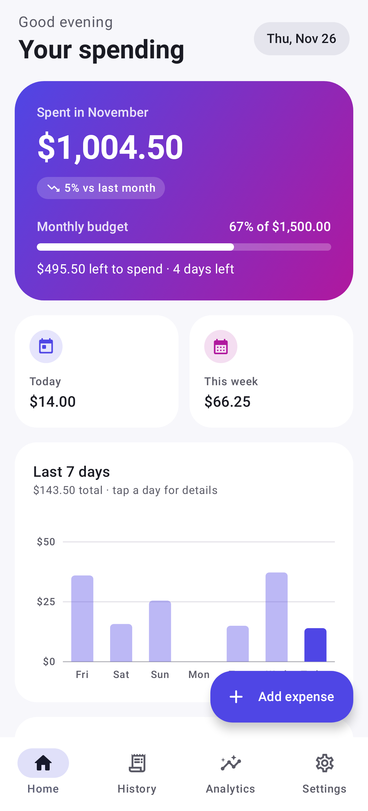
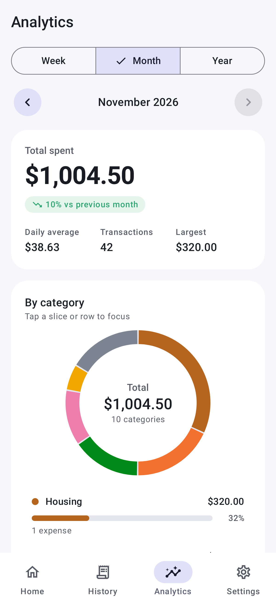
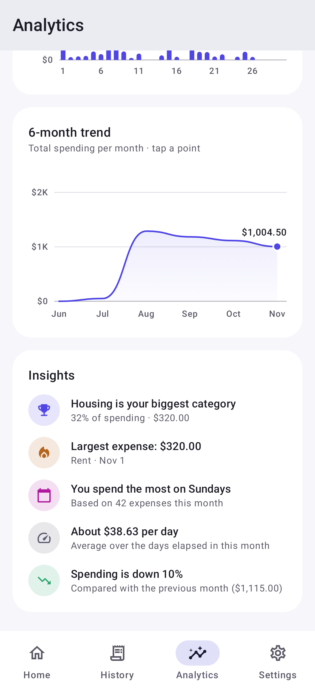
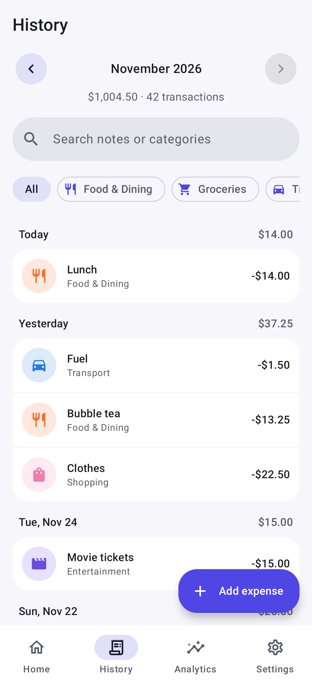
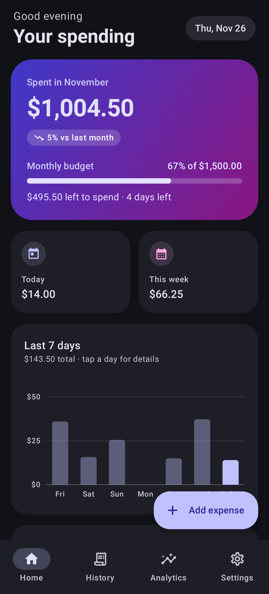

# Expense Tracker

An Android app for tracking daily expenses and seeing where your money goes, with interactive charts.
Built with Kotlin, Jetpack Compose and Material 3. Everything is stored on the device; there's no account and no internet use.

<p>
  
  
  
</p>
<p>
  
  
  
</p>

## Features

- **Fast entry**: big amount field, 12 color-coded categories, quick "Today / Yesterday" dates, optional note.
- **Home dashboard**: this month's total vs. last month, a monthly budget progress bar, today and this week, last 7 days chart, top categories and recent transactions.
- **Analytics** by week, month or year (step back through past periods):
  - Donut chart by category (top 5 plus the rest grouped), with a legend that shows each share and amount
  - Column chart of daily (or monthly) totals; tap a column to see its value
  - 6-month trend line; tap a point to see its value
  - Insights: biggest category, largest expense, the weekday you spend most, daily average, change vs. the previous period
- **History**: browse by month, search notes, filter by category, swipe left to delete (with Undo), tap to edit.
- **Settings**: 12 currencies (USD, EUR, KHR, THB, VND, …), monthly budget, light/dark/system theme, Material You dynamic color (Android 12+), CSV export through the share sheet, sample data, delete all.

## Install on your phone

**Easiest:** open the repository's **Actions** tab on GitHub, open the latest *Android build* run, and download the `expense-tracker-apks` artifact. Copy `app-release.apk` to your phone and open it. You'll need to allow installing from unknown sources.

**From source:** open the project in Android Studio (latest stable) and press Run, or use the command line with JDK 17+ and the Android SDK:

```bash
./gradlew assembleRelease     # → app/build/outputs/apk/release/app-release.apk (~2 MB)
./gradlew installDebug        # install a debug build on a connected device
```

> The release build is signed with the debug key so it installs directly. Before you publish to Google Play,
> create your own keystore and replace `signingConfig` in `app/build.gradle.kts`.

## Tech stack

| Area | Choice |
|---|---|
| UI | Jetpack Compose, Material 3, edge-to-edge, light/dark and dynamic color |
| Charts | Hand-written with Compose `Canvas` (no chart library): donut, column, smoothed line |
| Storage | Room (expenses), DataStore Preferences (settings) |
| Architecture | MVVM: `ViewModel` + `StateFlow`, a single-activity Navigation Compose app, a small manual DI container |
| Min / target SDK | 26 (Android 8.0) / 36 |

```
app/src/main/java/com/expensetracker/
├── data/        Room entity + DAO, repositories, settings, sample data
├── domain/      Analytics.kt — periods, totals, category shares, chart series (pure Kotlin, unit-tested)
├── ui/
│   ├── charts/      DonutChart, BarChart, LineChart
│   ├── components/  cards, rows, category colors and icons
│   ├── home/ history/ analytics/ edit/ settings/   one screen + ViewModel each
│   └── theme/       colors, typography, shapes
└── util/        money/date formatting, amount input sanitizing
```

## Tests

```bash
./gradlew testDebugUnitTest        # all tests
./gradlew recordRoborazziDebug     # also re-record docs/screenshots/*.png
```

- `AnalyticsTest`, `FormatTest`, `ChartScaleTest`: the calculations and formatting
- `AddExpenseFlowTest`: adds an expense through the real UI and checks it's saved and listed
- `Light/DarkScreenshotTest`: drives the real app with sample data and captures every screen (Robolectric + Roborazzi, no emulator needed)
